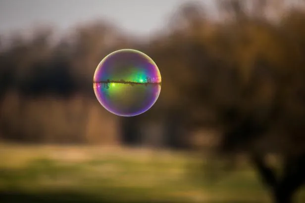
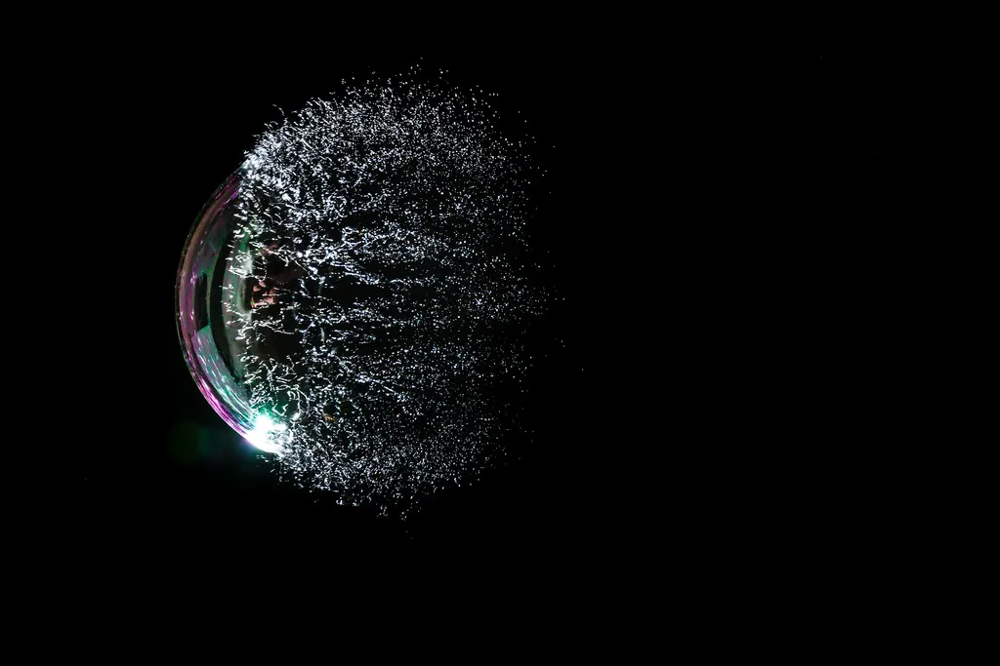

# Bolle di Mindfulness

Oggi la mia cuginetta mi ha chiesto di fare le bolle di sapone per lei. Erano anni che non mi capitava. Un intrattenimento semplice che se osservato dalla giusta prospettiva, svela profondi insegnamenti di vita.

Tre ingredienti: sapone, acqua e *uno spirito*.

Concentrazione.

*Soffio*. Un respiro calmo, controllato e costante.

Colori e forme in movimento.

Attesa.

**Creazione**. Ogni bolla volteggia nell’aria riflettendo la luce.

**Decorre**, in modo unico e irripetibile ma verso *la stessa Meta*.

In un istante, **scompare**. Si sprigiona nell’aria una brezza di profumo. Mutazione. Una moltitudine di goccioline.

*Sorrido.*

*Inspiro* per un *Nuovo Soffio*.

I bambini sono nostri maestri, ci insegnano indirettamente a vivere esperienze semplici con stupore, gioia e noncuranza verso il tempo. Esperienze che diventano un momento di pratica inestimabile.

Le bolle di sapone hanno in riserbo grandi insegnamenti anche per *i più piccoli*.

Richiedono soffi leggeri, per poter essere accompagnate nel loro volteggiare.

Richiedono premura e una ciotola d’acqua con qualche goccia di sapone, per potervi inumidire le mani e maneggiarle.

Richiedono pochi accorgimenti, per potervici relazionare. Gli stessi accorgimenti che, se continuati a coltivare, diventeranno virtù e *Li* accompagneranno nel *Loro volteggiare*.

Calma.

Temperanza.

Grazia.

Cuore.

**Grazie** *Marti*.

