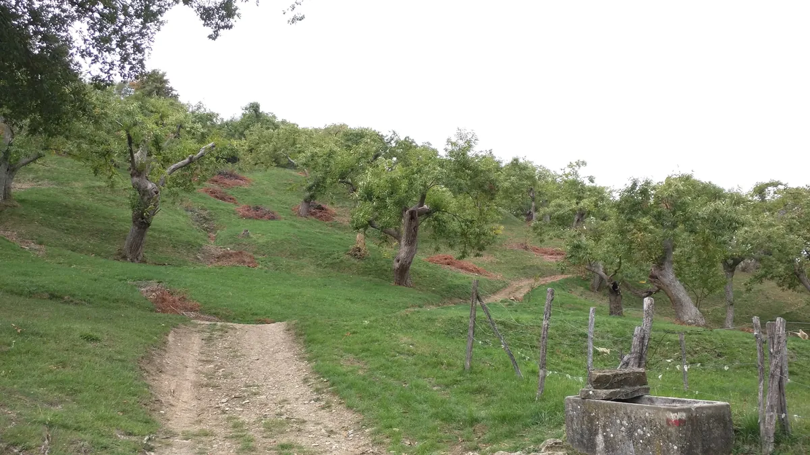
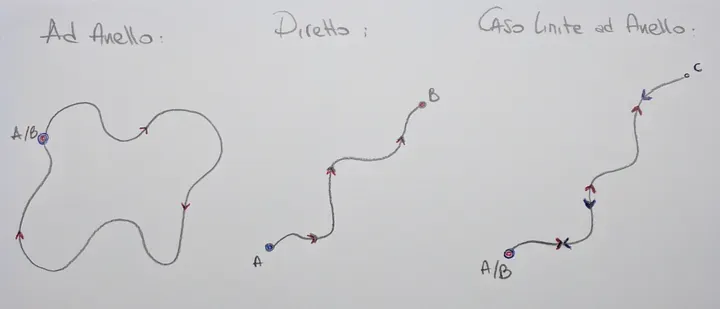
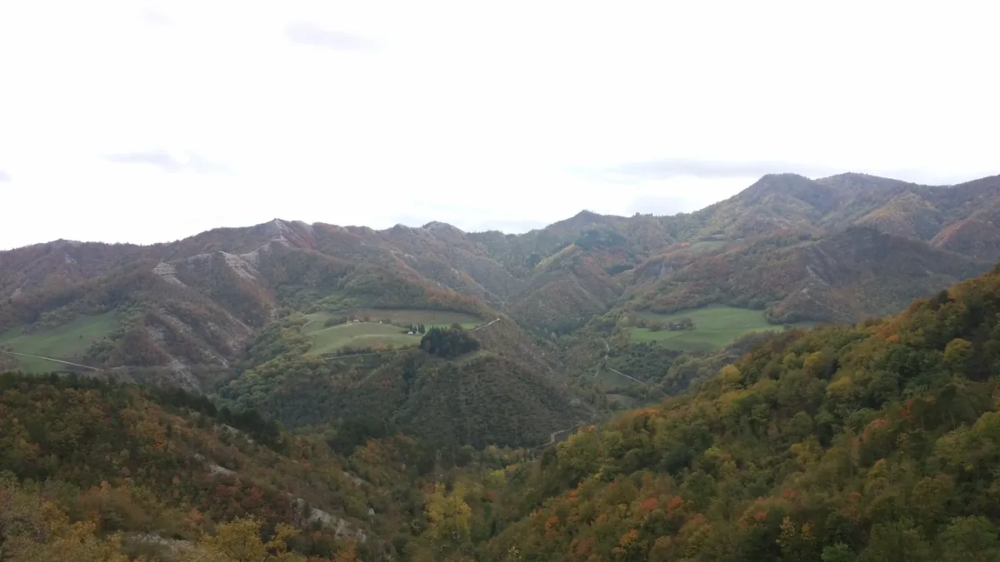

# Percorsi ad Anello

### Discutendo con un amico sulle tipologie di percorsi

**Asserzione**: Scegliere di provare per la prima volta un percorso ad anello(*\**) permette di sfruttare al meglio le nostre capacità(*\*\**).

**Motivazione**: I percorsi ad anello non hanno tragitti che si ripetono, in quanto non torni mai sui tuoi stessi passi.

Prima di addentrarci nella discussione e nei pensieri che sono scaturiti da questa asserzione, proviamo ad analizzare le varie parole che la compongono per percepire meglio il messaggio.

(*\**) Con percorso ad anello si intende una via, un tracciato che deve essere seguito ai fini di arrivare da un punto A ad un punto B.

(*\*\**) Con nostre capacità si intende la possibilità di intraprendere e concludere un tragitto ***sopra*** le nostre aspettative. Il corpo che supera la mente. Generalmente il corpo è fortemente dipendente da quello che si aspetta la mente. La forza di volontà infatti, ci permette di superare ostacoli anche quando **_sembrano_** insormontabili.

Tipi di percorso

**Anello**: La caratteristica fondamentale di questi sentieri è la condivisione di partenza e arrivo, inizio e fine. Inoltre, la strada che congiunge punto iniziale e punto finale è sempre nuova e diversa. Vedi eccezione caso limite. Non necessariamente deve essere a forma di anello, come si può vedere dalla figura.

**Diretto**: Classico esempio in cui si parte da un punto iniziale A e si arriva ad un punto B.

**Caso Limite**: Percorso diretto in cui partenza e arrivo coincidono. Arrivati ad
un punto arbitrario, denotiamolo con C, si torna sui propri passi,
ripercorrendoli a ritroso.

Se il percorso è sconosciuto, anche quando ci aspettano davanti a noi difficoltà, proseguiamo. L’ incognito ci fa andare avanti, ci accompagna. Ignari di quello che ci sarà, poniamo la nostra attenzione su ogni singolo passo, uno dopo l’altro.

Sapere cosa ci aspetta potrebbe demotivare. Gli ostacoli, con estrema calma e fermezza, ci attendono. Ne siamo consapevoli e la nostra anticipazione ci porta sconforto.

Come dicono spesso i saggi stoici:

> l’ uomo è portato a soffrire di più nell’immaginazione che nella realtà.

Siamo più spesso spaventati che realmente feriti. L’immaginazione delle difficoltà ce le fa *vivere* ancora prima che davvero si manifestino. Svia la nostra percezione a pensare di essere in difficoltà quando *realmente* non lo siamo.

Siamo molto più forti di quello che pensiamo, le nostra forza di volontà ci permette di superare difficoltà che trascendono l’immaginazione.

Ecco svelato il segreto sull’aiuto che possono darci i percorsi ad anello. Ci evitano di fantasticare o anticipare future difficoltà, seppure presenti.

Spero però, con queste poche righe, di aver trasmesso un’altra chiave di volta.

Il vero segreto in realtà, quello che davvero fa la differenza, non è sul tipo di percorso da intraprendere.

> Il vero segreto, si nasconde nella consapevolezza.

La consapevolezza che sono presenti mere fantasticherie portate alla luce dalla nostra mente. La consapevolezza che siamo più forti di quello che possiamo immaginare.

Cerchiamo di proseguire un passo alla volta, concentrandoci ed aggrappandoci a **Questo** momento, a **Questo** respiro, ***Sorridendo***…

