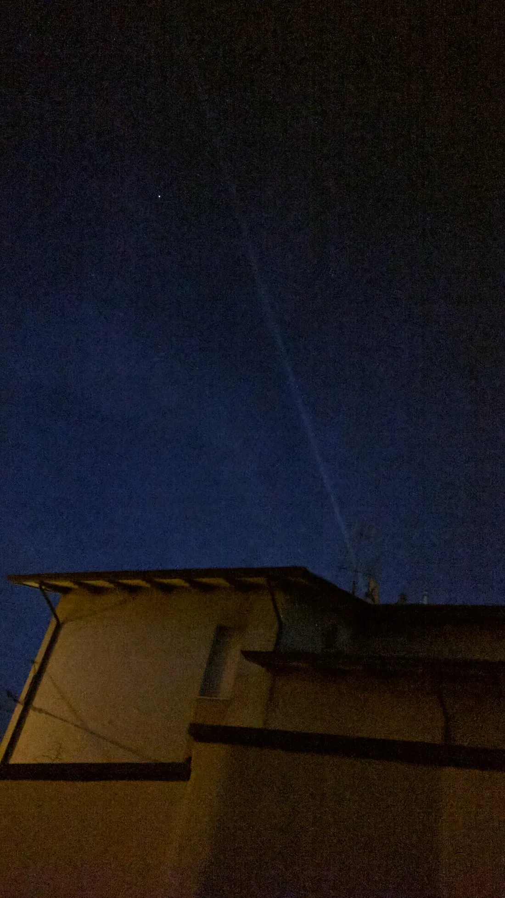

# Come le Stelle di Giorno

Cerchiamo l’illuminazione, ma camminiamo guardando per terra..

Pensiamo sempre al domani, ai giorni passati e con nostalgia ad albe e tramonti che sono un caldo ricordo lontano.

Ciechi, non comprendiamo quanto di bello ci circonda continuamente nel *Nostro Qui* e nel *Nostro Ora*..

*Da quanto* non ti soffermi a guardare le stelle?
*Da quanto* non guardi sorgere e tramontare il sole? Ricordi quei magnifici giochi di luce?
*Da quanto* non ti soffermi sul mutamento che avviene continuamente in natura?
*Da quanto* non riponi attenzione al ciclo delle stagioni?

Durante il tramonto i raggi del sole dipingono con sfumature di rosso tutto ciò su cui vi posano. Colori caldi si alternano, affievolendosi a poco a poco lasciando spazio a luccichii sparsi nel cielo..

Cominciano ad intravedersi alcune stelle sparse in qua e in là. Il chiarore
della luna dipinge con un bianco chiarore quel cielo, diventato ormai blu scuro.
*Ecco le stelle, nascoste ai più fino pochi istanti prima, nonostante veglino su
di noi, dall’alto, continuamente.*

Grazie ❤

*…Ascoltando Offering Chant di Lama Gyurme and Jean-Philippe Rykiel dall’album Rain of Blessing…*
