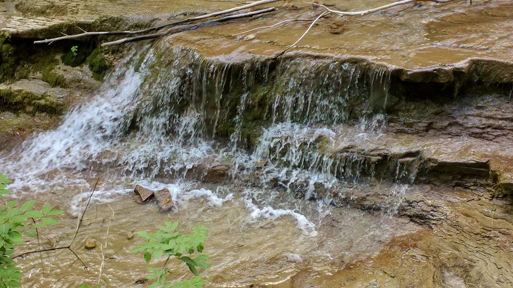

# Opposizione, Resistenza e Reazione

> *La Natura genera i fenomeni attraverso un gioco di forze complementari, in cui
> la forza attiva provoca la resistenza della forza passiva; è la reazione di
> quest’ultima che produrrà il fenomeno.* **Her-Bak (Cecio)**

Come in un ruscello,
l’acqua a valle fa resistenza all’acqua nuova.

Scorrendo, nuove piccole molecole ravvicinate cascano,
sentendo la resistenza e l’ opposizione da quelle già arrivate.

Reagendo tra loro, bollicine di aria si formano,
una candida effervescenza si forma dalla loro ascesa verso l’ alto.

La sostanza è Una.
Poco dopo, Tutto si quieta.
Un unico flusso:
Acqua, comunione di movimento e forme.

> *Occorre un’azione, una resistenza della stessa natura e la reazione o effetto. Il tutto è fenomeno vitale.* **Il tempio nell’Uomo**
