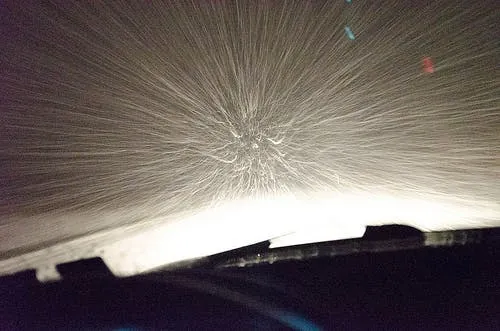

# Neve e Magnetismo

Stai guidando, assorto nei pensieri come gran parte del tempo. Il corpo e le azioni sono meccaniche, segui le macchine davanti, la tua mente vaga ed improvvisamente, succede. Osservi un particolare in quell’ ambiente sfocato che ti ha accompagnato durante tutto il tragitto.

L’ attenzione è saltata sulla Neve.

In lontananza la vedi scendere dolcemente dal cielo, verticalmente e pacatamente. I fiocchi sono tra loro in equilibro, equidistanti e con velocità proporzionale al proprio peso e alla propria forma.

Nel parabrezza tutto cambia. La velocità sembra aumentata notevolmente, una moltitudine di fiocchi si scioglie con un dinamismo intermittente e il loro movimento sembra come attratto magneticamente verso l’auto. Sembra come entrare in una galleria, un tunnel formato da tanti fiocchi di neve che ti vengono incontro.

Osservi.

Lento e veloce. Verticale e quasi orizzontale. Caduta dolce caduta di impatto. Opposti.

La Neve E’. Si adegua allo spostamento d’aria provocato dal tuo moto, dalla tua direzione, dal tuo agire. Sei la causa di questo effetto. La Neve semplicemente si allinea al tuo fluire. Ti fermi e tutto continua la sua dolce discesa.

Scegli la tua azione, scegli la tua direzione. Vedrai che tutto ciò che esternamente ti circonda, proprio come la neve, si allineerà.

Come un magnete ordina e polarizza ciò che di magnetico lo circonda, così la neve, **così le tue Azioni.**

*Sii la direzione.*
