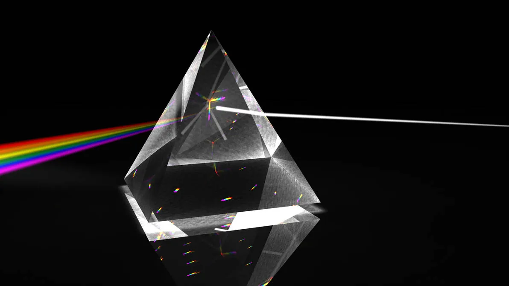

# Luce e Colori

Vi è la Luce.

Celate dai Tre Avi,
infinite sfumature,
sono libere di esprimere
una vibrazione.

Tutte Essenza-Una.
Brillante. Intensa. Pura.

Senza Nome.

*Thanks to [deviantart/hex13](https://www.deviantart.com/hex13) for the Photo.*
