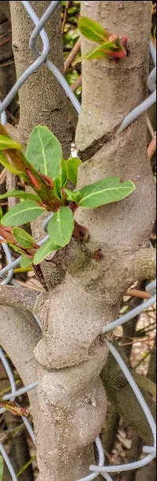

# Actus Vitae

Pensi che la **Natura** si preoccupi delle limitazioni esterne?

Cos’è una **limitazione**?

Cos’è **esterno**?

Consapevolmente, *esterno è interno ed interno è esterno*. Realizzalo, non vi sono confini. Verdi germogli esprimono la riuscita.

Difficile? Pensa e assimila le limitazioni, **persisti**.

**Actus Vitae.**
