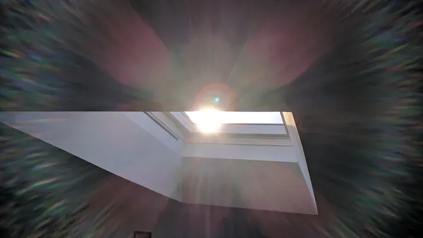
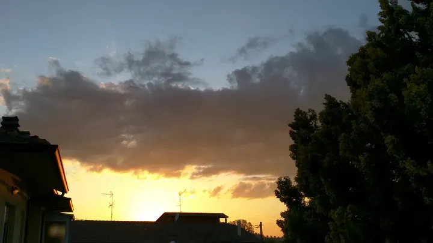

# Osserva il Sole

Osservalo attentamente.
Una porta è celata al suo interno.

Opposti.
Bianco e Nero.
Si crea il varco e l’aspetto cambia.
Gli estremi Sono uniti.
Luci e Ombre creano contorni in rilievo.
Nuvole acquistano spessore.

Il ricordo di un drago,
conferma antiche saggezze.

La non linearità dell’emanazione risulta svelata.

