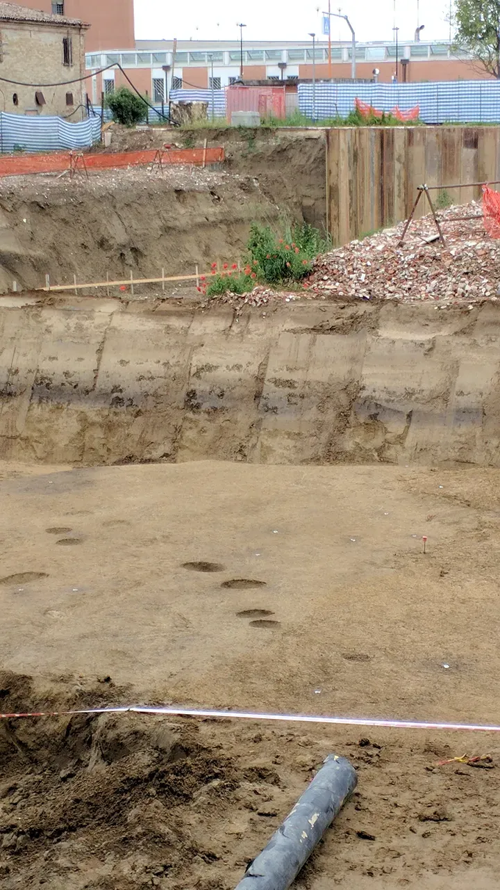

# Papaveri Scintillanti

Tra macerie e distruzione prepotente,
al Centro un’ Unica superstite.

Un ciuffo di Natura persiste co-esistendo,
nella casa comune con fratelli addormentati e sedati.
Testimone di un fare a-coscienzioso.

Piccole scintille rosse,
resistono,
continuano un ciclo,
sostenute dalla Terra maltrattata.

Scintille di speranza,
infondono resilienza ed energia a passanti silenziosi.
Testimoni e complici,
che in empatia vi dedicano brevi attimi di attenzione,
ad ogni passo in quel passare di Passaggio.

La Scintilla, nel suo attimo di esistenza,
risveglia tizzoni inerti attorno a Sé.

