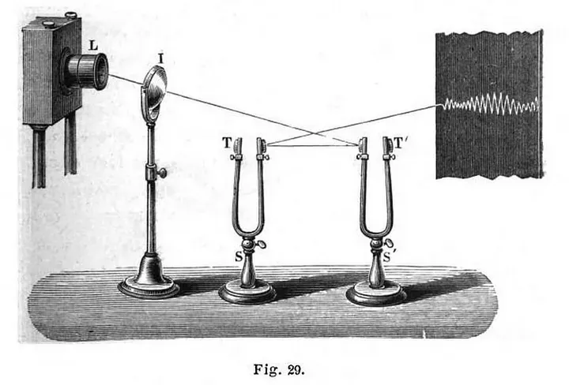

# Rintocco

Personalità, intreccio infinito.
Non lasciarti accecare dal loro canto,
illusione imperitura.

Innamorati dell’Essenza.
Manifestazione del vero Amore
che era, è, sarà.

Ascolta quel battito,
rintocco di un suono familiare,
origine primordiale.

Emanazione senza inizio ne fine,
nell’Altro risuona,
testimone dell’unicità
riflessa, riconosciuta, imperitura,
senza confini ne proprietà.

Osserva la creazione di questa risonanza,
allineamento di disegni atemporali
con copione sconosciuto.
