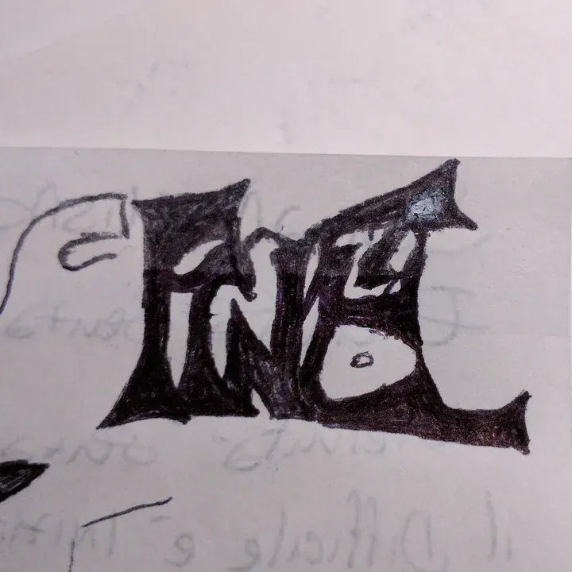

# In Fine Inizio

Cosa ci stimola a pubblicare un contenuto?

Impossibilità nel trasmettere un fotogramma, cerchiamo di estruderlo, metterlo
in mostra, come se la vista stessa fosse a testimonianza di quell’immagine
transitata, passata, vissuta e attualizzata in un'ulteriore immagine. Immagine,
in senso lato, vista di sbieco, toccata con mano, che ha suonato così familiare,
profumo di un ricordo condiviso, spezzettato, frantumato e riesumato.

Melodie di suoni troppo spesso considerati inudibili, ritornano, affiorano e
aleggiano in quello spazio che non si riesce a collocare.

Sfogo, eruzione, espulsione. Materia informe rimessa, all’altro, in quanto e per
quanto, tutto quanto è originato da tutt’Altro.

Eternità senza inizio contenuta in Eternità senza fine.
Movimento nella Quiete.
Ad infinitum.

[The PassOver - The soundtrack of our lives](https://www.youtube.com/watch?v=h-sexSLf-Ss)
