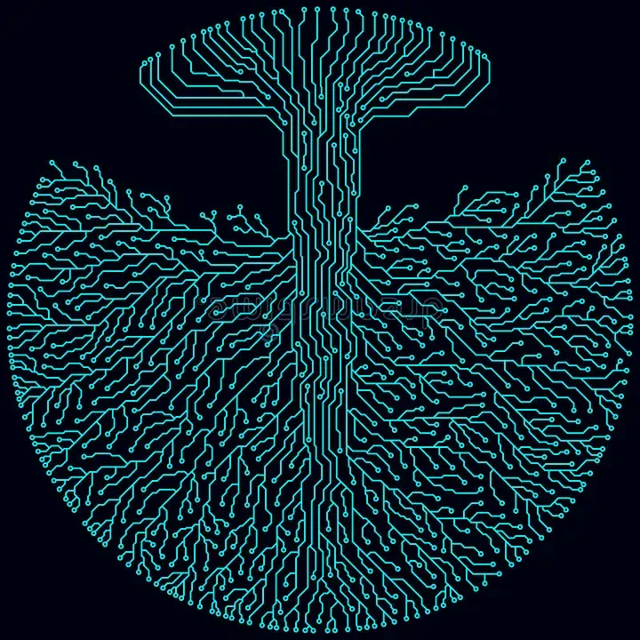

# Filii

Un filo collega Tutto
Tutti con Tutti,
Tutto con Tutti.

Sospeso o Messo a Terra,
Prossimità e Distanze Infinite,
Intermittenti Lucciole Diffuse,
Firmamento Binario.

Filiazione Ottica,
Corrente di Circuito Chiuso.
