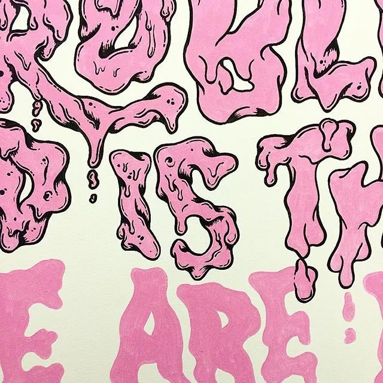
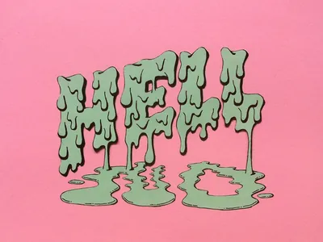

# Significato, sciolto fino a che punto?

Da un testo, si possono ricavare Verità, sciogliendo le parole, continuando alla ricerca di un nocciolo che (non) c’è.

Sciogli e risciogli, materia primordiale infinita. Perché chiedersi “cosa avrà voluto dire quella cosa” quando se si scioglie la domanda stessa si arriva a “cosa avrà voluto”. Tengo un verbo, in un tempo. Tre parole, indipendenti e disgiunte. Incoagulabili ed eternamente malleabili.

Si può smettere di fare della casa del Verbo un mercato? Quanti significati, da una frase sciolta si possono vendere? Il mercato è per sé, verso gli altri. Le candide verità, non possono essere vendute.

Meglio continuare a spazzare e coltivare.

