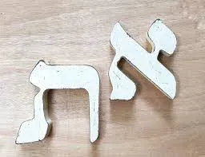

# Profondità

Profondità è ciò che permette anche la separazione.
בְּרֵאשִׁ֖ית בָּרָ֣א אֱלֹהִ֑ים אֵ֥ת הַשָּׁמַ֖יִם וְאֵ֥ת הָאָֽרֶץ׃

Aleph Tav.. l’alfabeto.. I simboli di rappresentazione.
Archetipici (celesti)
Ed effettivi (terreni)
Become a member

Separati e congiunti nella Vav.
Nella profondità.
Profondità come parte più intima, intima in quanto generalmente nascosta ad una prima vista. Di difficile veduta.

Distanza 2D
Profondità 3D

