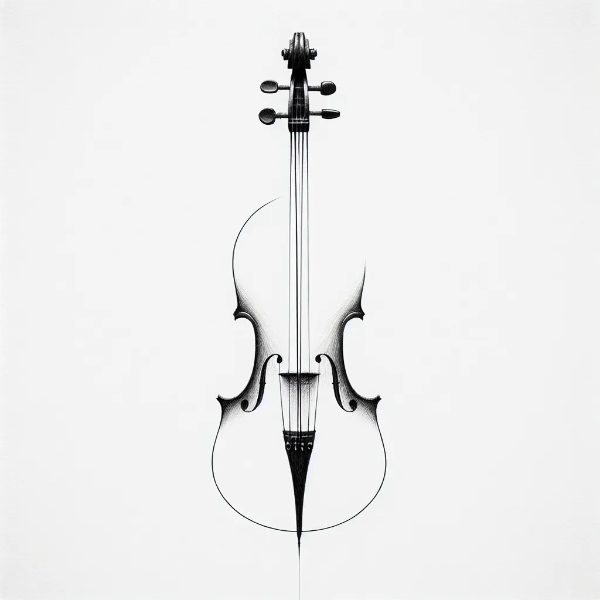

# Asso’Cio

La decisione di associarsi o non associarsi, la libertà di cui parla Viktor Frankl.

Reagire è essere vincolati.
Nella pura libertà, assenza di reazione.

Una corda è in tensione solamente quando due punti rimangono fermi e saldi nel loro posto.

Tai Chi Chuan.

Pace, in noi, da sé.

Semplice ricordo di libertà, in ogni istante disponibile.

