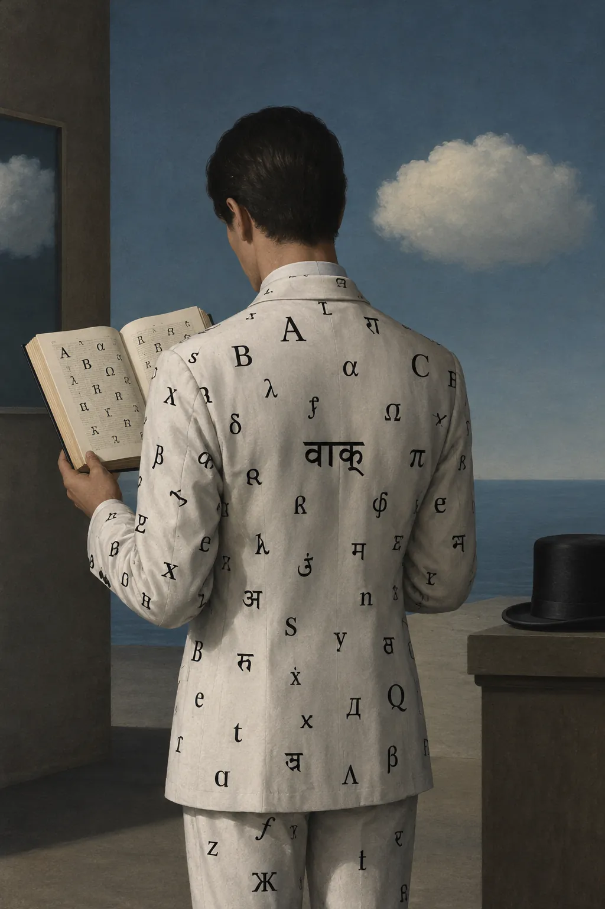

# Riconoscersi nel testo

Leggersi, non riconoscersi,
Domandarsi come e da quale luogo..
Parola si scrive,
Si vive l'Identità,
Identità di parola,
Io sono la parola,
La parola è me,
VAC-cino dell' ego che passa inosservato,
Non c'è osservatore né osservato.

Il tempo passa, io non sono nuovamente io,
Rileggo il testo,
Osservatore,
L'osservato è l'estraneo,
Ospitalità guardinga,
Sorrisi e poi saluti.

Un vuoto di stupore,
Parola esce,
Dalla porta e dal cuore.
Parola scritta nuovamente.

Nonostante la firma,
Non c'è appropriazione,
Esclusiva manifestazione.
M come Magnifica
G come Grazia

